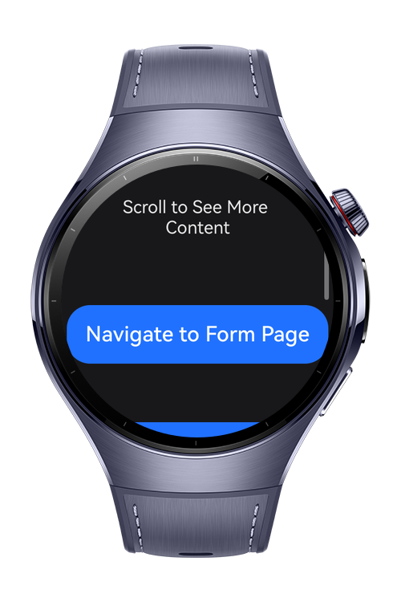
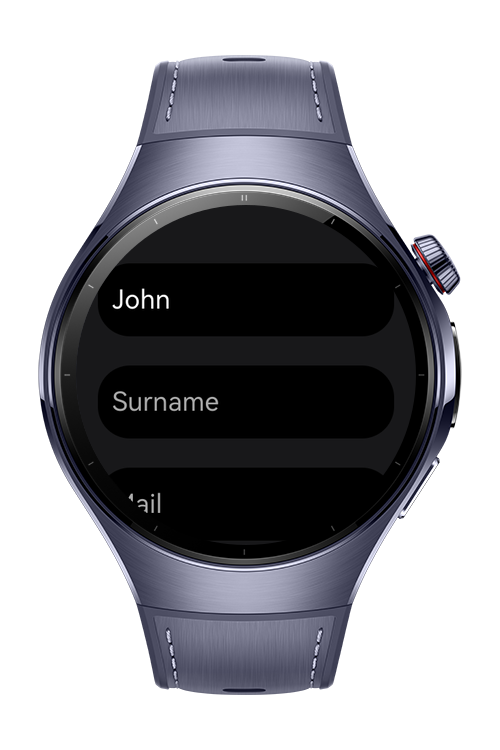
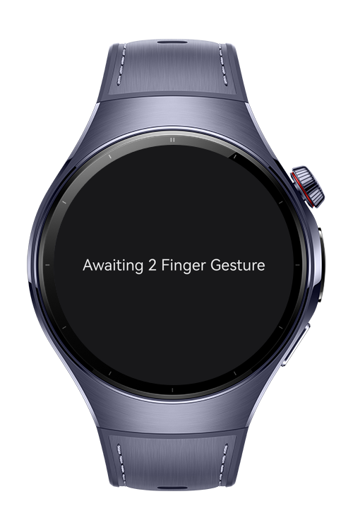

> **Note:** To access all shared projects, get information about environment setup, and view other guides, please visit [Explore-In-HMOS-Wearable Index](https://github.com/Explore-In-HMOS-Wearable/hmos-index).

# How To Build UI Automation

**How To Build UI Automation** is a HarmonyOS wearable CodeLab that demonstrates all UI testing functions. How to capture each state as screenshots, execute commands, perform complex gestures and more.
# Preview

<div>
  
  
  
  
</div>

# Use Cases

- **Navigate Through Pages**: Perform navigation in test functions and validate current page byy checking components.
- **Click on Components**: Click on buttons, forms etc. to trigger actions.
- **Take Screenshots**: Take screenshots and save them to a predefined location.
- **Perform Gestures**: Perform complex gestures that needs to be tested in the application.
- **Execute Commands**: Execute shell commands while performing UI tests.

# Tech Stack

- **Languages**: ArkTS, ArkUI
- **Frameworks**: HarmonyOS SDK 6.0.1 (API 21)
- **Tools**: DevEco Studio NEXT
- **Libraries**:
  - `@kit.TestKit`
  - `@kit.AbilityKit`
  - `@kit.PerformanceAnalysisKit`
  - `@ohos.hypium`
  
# Directory Structure

```text
entry/src/main/ets/
├── entryability/
│   └── EntryAbility.ets
├── entrybackupability/
│   └── EntryBackupAbility.ets
└── pages/
    ├── FormPage.ets                # Page that contains input fields
    ├── GesturePage.ets             # Page that has a component changes with two finger gesture
    ├── Index.ets                   # Entry page that contains navigation buttons.
    └── NavigationContainer.ets     # Navigation Container

entry/src/ohosTest/ets/test
├── List.test.ets                   # List of test classes
└── UITest.test.ets                 # Class that contains all UI Tests
```

# Constraints and Restrictions

## Supported Devices

- Huawei Watch 5
- DevEco Studio Simulator

# License

**How To Build UI Automation** is distributed under the terms of the MIT License.
See the [LICENSE](/LICENSE) for more information.
